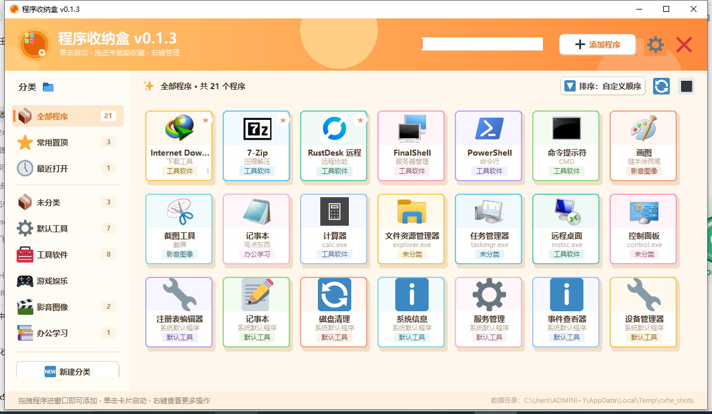
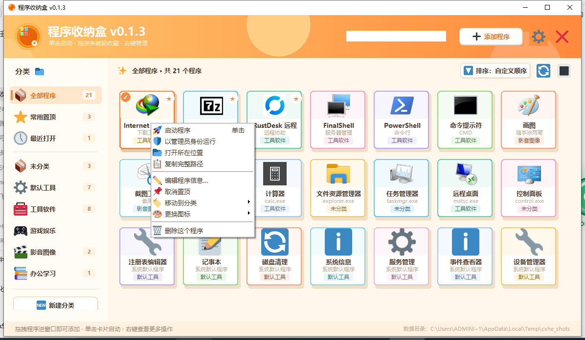
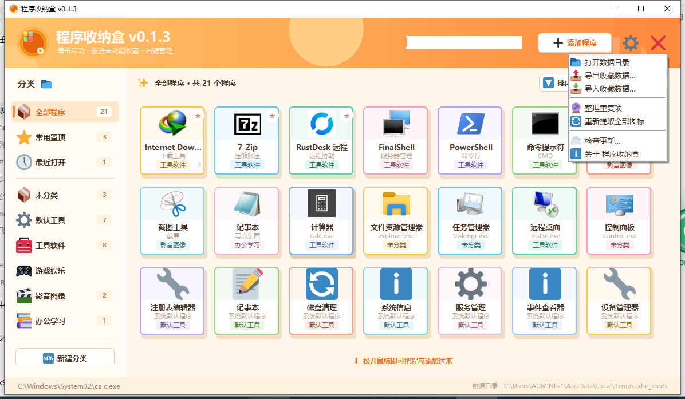

# 程序收纳盒

一个卡通风格的 Windows 程序收藏夹：把常用的 exe、桌面快捷方式拖进窗口即可收藏，
单击启动，右键编辑 / 删除 / 分类 / 换图标。单文件绿色版，数据和图标都放在 exe 同目录，
拷走整个文件夹就能换电脑使用。

当前版本：**v0.1.9**

## v0.1.9 更新内容

- **修复升级后自动重开报「Failed to load Python DLL」。** 覆盖成功只代表旧
  exe 的文件锁放开了，界面进程还在收尾，单文件程序解出来的 `_MEI…` 临时目录
  也还没删干净；这时立刻拉起新程序，新实例会去已经消失的临时目录里找
  `python312.dll`，弹错误框、必须手动再开一次。现在更新助手会先轮询进程表，
  等旧实例彻底退出并留 1.2 秒收尾时间，再启动新程序。
- **重启时不再继承脏环境变量。** 单文件程序的界面进程自带 `_PYI_*`、
  `TCL_LIBRARY`、`TK_LIBRARY` 等指向自身临时目录的变量，以前会一路传给新进程，
  现在拉起助手前会把这些清掉。
- **设置密保默认只给一组问题和答案。** 原来是固定三行，现在一行起步，
  需要更多点「＋ 添加问题」，窗口高度跟着组数自动增减。

## v0.1.8 更新内容

- **升级完成后一定会自动重新打开程序。** 更新助手启动新程序时的引号写法在
  带空格 / 中文的路径上不可靠，可能覆盖成功却没有把程序拉起来；现在改用
  安全拼接并把工作目录设为程序所在目录，实测中文带空格路径也能自动重开。

## v0.1.7 更新内容

- **修复升级后仍是旧版本。** 更新脚本生成后没有被真正启动，程序退出后无人
  覆盖 exe；现在会拉起独立助手，等旧进程退出后复制并重启，中文路径也不再受
  控制台编码影响。
- **修复最大化后显示全部程序。** 卡片复用池里的其它分类卡片会被重新铺出来；
  现在布局只排当前分类可见的张数。
- **分类列表可滚动，「新建分类」不再被挤出屏幕。** 底部按钮区优先占位，
  分类多时列表在中间滚动，小窗口一打开就能看到按钮。
- **修复卡片区 / 分类列表滚不动。** 滚动范围没有登记给画布，滚轮和滚动条
  都无效；现在两者都能正常上下滚动。
- **有密码就必须有密保。** 设置密码时若还没填密保问答，保存会直接弹出
  「设置密保」窗口，至少填好一组问题和答案才能保存。

## v0.1.6 更新内容

- **密保问题独立成窗。** 编辑分类里的「设置密保问题…」会打开独立窗口，
  按「问题一 / 答案、问题二 / 答案、问题三 / 答案」的形式填写，默认三组、
  可增删；答对任意一组即可找回密码。
- **修复频繁最大化后卡死。** 窗口缩放时成批的尺寸事件会先合并再处理，
  整窗重绘改为节流并在尺寸稳定后补画，连续最大化 / 还原不再拖住界面。
- **对话框自动避开任务栏。** 小屏幕或任务栏占位时对话框会上移，保存按钮不会被挡住。
- 修复滚动条在窗口尺寸变化后消失的问题。

## v0.1.5 更新内容

- **分类密码。** 新建或编辑分类时可以设置「打开密码」，密码不限制长度和字符；
  进入该分类需要输入密码，输对后 **24 小时内免输**，过期重新询问。
  不设密码的分类和以前一样，点开即进。
- **忘记密码找回。** 设置密码时至少要填一条「密码提示（问题 + 答案）」，
  可点「＋ 添加提示」加多条；提示只属于当前分类，各分类互相独立。
  密码框里点「忘记密码？点这里找回」，答对任意一条提示会**直接显示密码**并解锁该分类。
- **加密分类里的程序不会外泄。** 未解锁时，这些程序不会出现在
  「全部程序 / 常用置顶 / 最近打开」和搜索结果里，只能从加密分类进入。
- **导出/导入包含密码信息。** 导出的 JSON 里带密码、找回问题和答案，
  换电脑导入后密码依然有效。

## v0.1.4 更新内容

- **启动后自动检查更新。** 界面显示后约 4 秒在后台静默查询发布页，有新版才弹出
  「发现新版本」提示（带增量包大小），无更新或网络失败不打扰；同一台机器 6 小时内
  不会重复请求。
- **更新源切换为 Gitee。** 优先查询 Gitee 发布页，不可达时自动回退 GitHub Releases。
  两个平台都会同步发布 exe 与增量补丁。

## 下载

- Gitee：<https://gitee.com/wenming760/chengxuhe/releases/latest>
- GitHub：<https://github.com/wenming758/chengxuhe/releases/latest>

## 界面预览



| 右键菜单 | 设置菜单 |
| --- | --- |
|  |  |

## v0.1.3 修复内容

### 1. 部分程序图标在收纳盒里只有「小米粒」大（已修复）

一些 exe（如 IDM 绿色版）从系统 JUMBO 图像列表拿到的是一张 256×256 画布，
真正的图标只画在左上角 48×48 区域。旧版把整张画布缩到 48px，图标自然只剩
几个像素。现在提取后会先按不透明像素包围盒裁掉透明留白，再缩放缓存；
旧缓存（`iconv < 2`）会在启动后由后台线程自动重抓一次，界面无需任何操作。

### 2. 检测更新 + 增量更新（新增）

检测更新会查询发布页（v0.1.4 起优先 Gitee，失败自动回退 GitHub）。发现新版本时：

- 如果发布里带 `patch_旧版_to_新版.bin` 增量包，就只下载这个补丁（通常几 MB），
  在本地用滚动校验 + zlib 合并出新版 exe，`sha256` 校验通过后才替换；
- 补丁缺失或合并失败时才回退下载完整安装包；
- 全程用进度条展示「下载增量补丁… / 正在合并更新…」，替换仍由原来的
  `update_helper.vbs` 在退出后完成，只覆盖 exe 本身，`apps_data.json` 和
  `icons/` 原样保留。

### 3. v0.1.2 的修复一并包含

拖入快捷方式后删除桌面 `.lnk` 不再失效（存真实 exe 路径 + 参数 + 工作目录，
启动走 CreateProcess，实测 IDM 从 2.3 秒降到 0.02 秒）；界面、主题、布局与
操作方式完全不变。

## 目录结构

```
src/                源码
  main.py           入口与主界面
  store.py          数据层（apps_data.json）
  linkfix.py        快捷方式独立化（.lnk -> 绝对路径）
  spawner.py        快速启动（CreateProcess / ShellExecute）
  iconutil.py       图标提取（裁透明留白）
  delta.py          增量补丁合并（rsync 式滚动校验）
  widgets.py        卡片 / 按钮 / 对话框
  theme.py          主题与字体
  assets.py         路径与 emoji 资源
  build.spec        PyInstaller 打包配置
tools/              调试与测试脚本（make_patch.py 生成增量补丁）
使用说明.md          用户手册
程序收纳盒.exe       已打包的单文件程序
```

## 构建

```bash
pip install pyinstaller windnd pywin32
python -m PyInstaller src/build.spec --noconfirm --clean
```

产物：`dist/程序收纳盒.exe`（单文件，无需 Python 环境）。

## 数据与隐私

- `apps_data.json`、`icons/` 是本机用户数据，已加入 `.gitignore`，不会提交到仓库；
- 源码中不包含任何账号、密码或令牌，发布与推送使用本机 Git 凭据。
